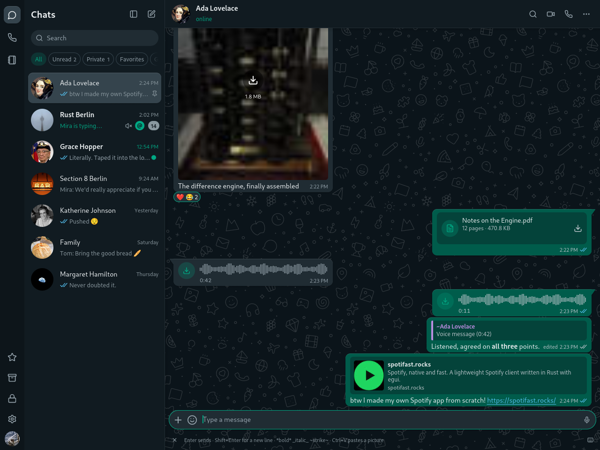

<p align="center">
  
</p>

<h1 align="center">ZapFastie</h1>

<p align="center"><strong>WhatsApp, native and fast.</strong><br>A lightweight desktop app for your chats on Linux, macOS, and Windows, on its way to one window for chats, mail, and notes.</p>

<p align="center">
  <a href="#install"><strong>Install</strong></a> ·
  <a href="docs/_guide/getting-started.md">Getting started</a> ·
  <a href="docs/_guide/using-zapfastie.md">User guide</a> ·
  <a href="CONTRIBUTING.md">Contribute</a>
</p>

<p align="center">
  <a href="Cargo.toml"></a>
  <a href="#install"></a>
  <a href="LICENSE"></a>
</p>

ZapFastie is a WhatsApp client written in Rust with
[egui](https://www.egui.rs) and [fastframe](https://fastframe.dev), the
framework behind a family of native desktop apps. It links to your phone as a
companion device through
[whatsapp-rust](https://github.com/oxidezap/whatsapp-rust) and has no browser
engine. In our Linux test it opens in under a second and uses about 200 MB of
idle RAM, against 1.13 GB for WhatsApp Web.
[See the measurements](docs/_reference/benchmarks.md).

This fork is growing into a communication hub: the chats you have today, then
a mail inbox built on the IMAP and SMTP accounts you already own, then notes
kept on this computer that can cite a message or a mail. Chats come first and
stay first. Notes are built and are their own tab, where a note in markdown
can point at a message and take you back to it. Mail is not built yet: the
account model, the reader that turns a mail into text, and the encrypted
archive beside the chat one exist, with no screen and no IMAP connection.

The interface is available in English, Chinese (Simplified and Traditional),
Dutch, French, German, Indonesian, Italian, Portuguese (Brazil), Russian,
Spanish, and Turkish.

<picture>
  <source media="(prefers-color-scheme: light)" srcset="docs/screenshot-light.png">
  
</picture>

[Features](#your-chats-on-your-desktop) · [Install](#install) · [Link your phone](#link-your-phone) · [Help](#guides-and-help)

## Your chats, on your desktop

| Feature | What you can do |
|---|---|
| **Messages** | Send formatted text, replies, edits, reactions, forwards, pictures, files, stickers, GIFs, polls, and voice messages. |
| **Media in the chat** | Play voice messages, videos, round video messages, GIFs, and animated stickers in place. |
| **Your history** | Keep your chats in an encrypted archive on this computer, fetch older messages from your phone as you scroll, and export locally saved chat history as text or a ZIP with downloaded attachments. |
| **Calls** | Place and answer voice and video calls, with your choice of microphone, speaker and camera. |
| **Notes** | Write markdown notes kept on this computer, search them, and cite the message a note was written about. |
| **Several numbers** | Link more than one WhatsApp number and switch between them in one window. |
| **Desktop controls** | Use keyboard shortcuts, select and copy text across messages, and stay linked in the tray with notifications. |
| **Themes** | Choose light, dark, system appearance, or custom colours. On Omarchy, follow your desktop theme. |
| **Privacy** | Hide locked chats behind a code, or the whole window behind an app lock. Nothing goes to a server of ours. |

## Where this fork is going

| Step | What it adds | State |
|---|---|---|
| **Notes** | A tab of notes kept on this computer, markdown, able to cite a message from a chat | **Built**: the tab, the search, and a note that points at a message and opens it |
| **Mail, reading** | Accounts you configure over IMAP, read offline from an encrypted archive beside the chat one | Foundations: the account model, the text reader and the archive exist; the connection and the screen do not |
| **Mail, writing** | Reply, reply to all, forward and send over SMTP, with attachments | Not started |
| **Together** | A note that points at a mail or a message and takes you back to it, and one search across the three | A note already points at a chat message; the mail side waits for mail |

What the hub will not become, because the client is worth more than the
feature list: no other chat networks, no bridge that turns a chat message into
mail or the reverse, no web view and no HTML engine inside the app, and no
server of ours anywhere in the path. Mail talks to your provider and to nobody
else. A message that needs a layout this app does not draw opens in your
browser, on purpose, one message at a time, because the alternative is shipping
a browser engine inside a client that exists to not be one.

## Install

This fork has not published a release, so there is no installer or package to
download yet. Building it takes a few minutes once the dependencies are in
place:

| Platform | Installation |
|---|---|
| **From source** | Clone the repository, then `cargo install --path .` and start `zapfastie`. [Getting started](docs/_guide/getting-started.md) lists the build dependencies, for Arch, Debian and Ubuntu. |
| **Linux, with a launcher entry** | `cargo build --release --locked`, then `packaging/install-user.sh`: it installs the binary, the icon and the desktop file under `~/.local`. |
| **Arch Linux** | The recipe (`PKGBUILD.in`) is in `packaging/arch/zapfastie/`; the release workflow fills it in and publishes it to the AUR. It is not there yet. |
| **Nix** | `nix run .#zapfastie` from a clone, or install the flake's package. There is a Home Manager module. |
| **Prebuilt binaries** | None yet. [Releases](https://github.com/joao-pedro-gms/zapfastie/releases) is where the macOS app, the Windows installer, the packages and the Flatpak will land. |

## Link your phone

1. Open ZapFastie. It shows a QR code.
2. On your phone, open WhatsApp, then **Settings**, **Linked devices**,
   **Link a device**, and scan the code. Or click **Link with phone number**
   and enter the eight-character code on your phone.
3. Your recent chats arrive from the phone. Older messages follow as you
   scroll up.

The link survives restarts, and your phone does not need to stay online to
read what ZapFastie has already stored. See
[Getting started](docs/_guide/getting-started.md) for the full
walkthrough and [How it links](docs/_reference/how-it-links.md) for the
details.

## Guides and help

The guide lives in [`docs/`](docs/), written for a site this fork has not
published. The pages read as markdown here; the links between them assume that
site, so some lead nowhere on GitHub.

| You want to… | Read |
|---|---|
| Know what ZapFastie does and does not do yet | [What is ZapFastie?](docs/_guide/what-is-zapfastie.md) |
| Link your phone or build from source | [Getting started](docs/_guide/getting-started.md) |
| Install it on Linux, and what the choices are | [WhatsApp on Linux](docs/_guide/whatsapp-on-linux.md) |
| Learn messages, stickers, polls, and shortcuts | [Using ZapFastie](docs/_guide/using-zapfastie.md) |
| Find settings, stored files, encryption, the app lock, and updates | [Settings and files](docs/_reference/settings-and-files.md) |
| Make your own theme | [Making a theme](docs/_reference/themes.md) |
| Understand what stays on this computer | [How it links](docs/_reference/how-it-links.md) |
| See startup time and idle memory, and how they were measured | [Memory and startup measurements](docs/_reference/benchmarks.md) |
| Understand account risk | [Account safety](docs/_guide/what-is-zapfastie.md#account-safety) |
| Report a bug or propose a feature | Read [Contributing](CONTRIBUTING.md). GitHub issues on this fork are off, so there is no report form yet. |

## Contributing

Read [CONTRIBUTING.md](CONTRIBUTING.md) before opening an issue or pull
request. To look at the interface without a WhatsApp account, run:

```sh
cargo run --features demo -- --demo
```

[AGENTS.md](AGENTS.md) describes the architecture, [DEMO.md](DEMO.md) the
demo pages, screenshots, and recorded tours, and
[PACKAGING.md](PACKAGING.md) releases and packages.

Native notifications use Fastframe on Linux, macOS and Windows. ZapFastie keeps
its account/chat routing, privacy settings, notification limits and sound
previews. Clicks open the announced message; reading a chat withdraws its
tracked notifications. OS permissions and notification presentation still apply.


## More native apps

**Want Spotify just as fast and native?** [Spotifast](https://spotifast.rocks)
is ZapFastie's sibling. Both are built on
[fastframe](https://fastframe.dev).

## Acknowledgements

ZapFastie uses [whatsapp-rust](https://github.com/oxidezap/whatsapp-rust),
[egui](https://www.egui.rs), [fastframe](https://fastframe.dev), the
[Inter](https://rsms.me/inter/) typeface and Noto Color Emoji (OFL), and
[Lucide](https://lucide.dev) icons (ISC), also used for the chat wallpaper
doodles. The notification sounds are [Pidgin](https://pidgin.im)'s, under the
GPL-2.0 (see `assets/sounds/`).

ZapFastie began as a fork of [ZapFast](https://github.com/crmne/zapfast), by
Carmine Paolino, and keeps its architecture and most of its code. ZapFastie is
an unofficial client and is not affiliated with WhatsApp or Meta. Using an
unofficial client may be against WhatsApp's terms of service and could get an
account suspended. Use it at your own risk. WhatsApp is a trademark of
WhatsApp LLC.

Mail, once it ships, reaches the account you configure and nothing else: no
relay of ours, no copy on a server we run, and no analytics on what arrives.
Notes stay on this computer.

Licensed under the [MIT License](LICENSE).

## Star history

<a href="https://www.star-history.com/?repos=joao-pedro-gms%2Fzapfastie&amp;type=date">
  <picture>
    <source media="(prefers-color-scheme: dark)" srcset="https://api.star-history.com/chart?repos=joao-pedro-gms/zapfastie&amp;type=date&amp;theme=dark">
    
  </picture>
</a>
